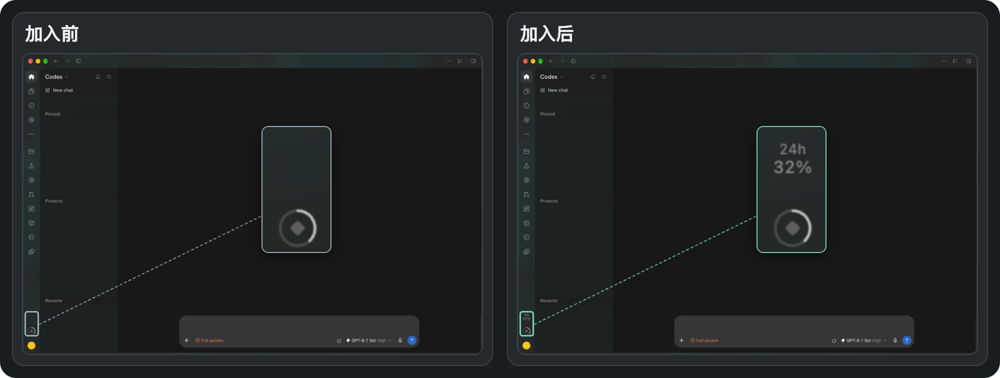

# Codex 额外重置预测

在 Codex 桌面版左下角、原生 Usage 按钮上方，直接查看额外额度重置的概率。支持 Codex Tweaks 功能包，也可以在 macOS 上安装独立启动助手。



*界面预览，使用示例预测数据。*

## 怎么用

- 左下角默认显示未来 **48 小时**的预测概率。点击可查看未来 12、24、48、72 小时的估算，以及预测更新时间和来源。
- 在「左下角显示」里选择时段。选择即时生效并保存在本机，详情仍显示四个时间窗口。
- 观测站收录明确的公开预告时，详情会显示预告类型和已知时间，有原帖链接时可直接打开。数据过期时，左下角显示「—」，详情标记上次预测。
- 入口紧贴原生 Usage，Codex 的下载更新按钮会排在它上方。面板随 Codex 切换深色和浅色主题。

## 安装为 Codex Tweaks 功能包

需要已安装的 Codex 桌面版、支持功能包 API v3 的 Codex Tweaks，以及 Node.js 20.3 或更新版本。从 Git 安装还需要 Git。 [Codex Tweaks 下载与连接说明](https://github.com/codex-tweaks/codex-tweaks#开始使用)

1. 打开 Codex Tweaks，在概览确认已连接 Codex。若首次连接时提示「重启并连接」，保存工作后按提示操作。
2. 在「功能包」选择一种安装方式。
   - **本地安装**。选择本项目目录（包含 `package.json`）或对应的 ZIP。
   - **从 Git 安装**。填入本项目的 Git 仓库地址，选择「最新 SemVer 标签」或指定的版本标签。
3. 在 `ct-reset-forecast` 的卡片中完成编译并启用，阅读 Node 权限说明后为当前版本授权。
4. 回到 Codex，在 Usage 上方点击「48h」打开预测。停用功能包即可移除入口。

已在 macOS 上使用 Codex Tweaks v3.5.11 验证。Windows 尚未实测。Codex 更新后如果连接断开，可通过 Codex Tweaks 重新连接。若桌面版调整了导航结构，功能包可能需要适配。

## macOS 独立运行

独立方式使用原来的 Codex 图标。macOS 在登录会话中运行一个小型启动助手。它只检查刚启动、位于前台且尚无新输入的 Codex，符合条件时正常退出并重开一次。Codex 完全退出后，预测后台随之停止，启动助手继续等待下次启动。

需要 Node.js 22+、Xcode Command Line Tools，以及位于 `/Applications/ChatGPT.app` 的官方桌面客户端。从仓库目录运行：

```bash
bash standalone/install.sh install
```

安装后，在方便时用 `⌘Q` 退出 Codex，再从原来的图标打开。若 Codex Tweaks 正在管理当前窗口，先退出 Tweaks。启动助手不会接管安装前已打开的 Codex，快速重复打开或启动时立即操作也可能跳过本次接管。

```bash
bash standalone/install.sh status
bash standalone/install.sh uninstall
```

启动助手仅在本机运行，使用随机回环端口连接它启动的 Codex 实例。Codex 应用文件和签名保持原样。它使用桌面端的内部界面结构，Codex 更新后可能需要重新适配。卸载后可重新打开 Codex 以结束本次启动留下的本地调试连接。显示时段保存在 `~/Library/Application Support/Codex Reset Forecast/data`。

此方式参考了 [Codex Usage Card 的启动和界面分离方式](https://github.com/Lorie7813/codex-usage-card/releases/tag/v0.9.5-beta.1)。

## 预测来源与权限

概率由 **Codex Reset Observatory（Gussuri Works）** 提供。它估算额外重置事件，可能包含直接恢复额度或发放重置卡。请在原生 Usage 中查看个人额度和常规重置时间。社区估算仅供参考。 [观测站](https://codex.gussuriworks.com/zh) · [公开 API 文档](https://github.com/gussuri/codex-reset-observatory#public-api)

- **界面**仅查找桌面端导航栏与 Usage 入口以定位按钮，并绘制预测面板。代码不读取对话、账户额度或登录凭据。
- **Node 后台**以当前系统用户运行。Tweaks 安装方式由宿主按版本授权，独立方式通过 macOS 用户级启动任务运行。上游未开放浏览器跨域访问，包通过 Node 向 `codex.gussuriworks.com/api/current?locale=zh` 请求公开 JSON，无需账号或 API 密钥。正常情况下成功请求至少相隔 10 分钟，失败后按需重试。
- **本地数据**只在所选安装方式的数据目录中保存显示时段（`settings.json`）。预测快照仅缓存在内存中。

## 开发

项目没有第三方运行时依赖。使用 Node.js 20.3 或更新版本执行 `npm test`，测试覆盖上游响应解析、缓存及本地设置。

- `src/index.js` 和 `src/style.css` 负责入口、面板与主题。
- `src/node.js` 负责请求、响应校验和本地设置。
- 将项目目录通过 Codex Tweaks 本地安装，改动后在功能包页面重新编译。请在实际客户端检查深浅主题、设置切换、更新按钮位置及停用后的清理。

## 许可证

项目代码采用 [MIT License](LICENSE)。感谢 Codex Tweaks 提供桌面功能包宿主，以及 Codex Reset Observatory 提供公开预测数据。
