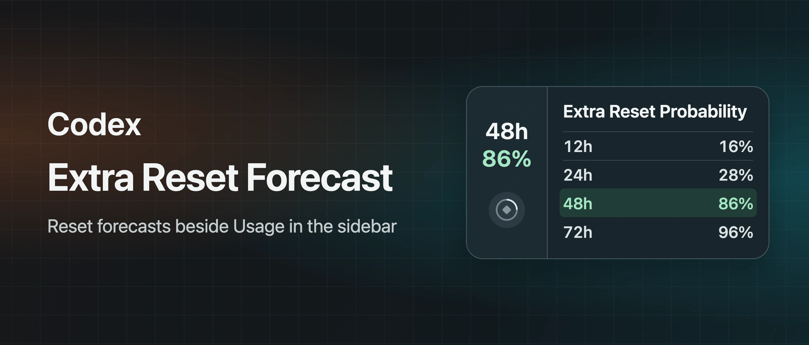
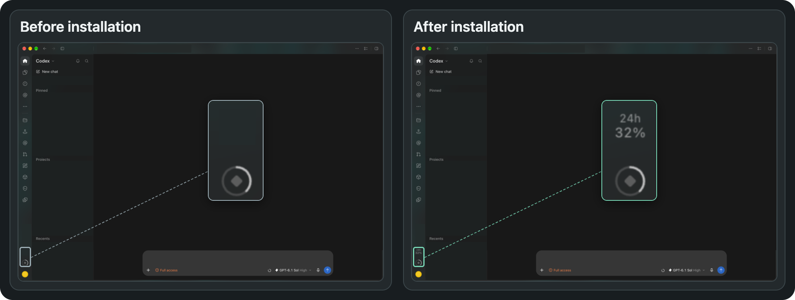

# Codex Reset Forecast

**English** · [简体中文](README.zh-CN.md)

> See the forecast for extra resets alongside the built-in Usage indicator in the Codex sidebar on macOS. Install once and keep opening Codex from its usual icon.

[](#requirements)
[](#requirements)
[](#installation)
[](LICENSE)
[](https://github.com/key-student/codex-tweaks-reset-forecast/stargazers)



*Interface illustration with example probabilities.*

[Installation](#installation) · [Before and after](#before-and-after) · [FAQ](#faq) · [Star History](#star-history) · [Acknowledgments](#acknowledgments)

## Installation

Check the [requirements](#requirements) before installing.

### Download the ZIP

1. [Download the source ZIP](https://github.com/key-student/codex-tweaks-reset-forecast/archive/refs/heads/main.zip) and extract it.
2. Open Terminal, type `cd ` (with a trailing space), drag the extracted project folder into Terminal, and press Return.
3. Run the installation command.

```bash
bash standalone/install.sh install
```

The installer runs under your macOS user account and needs no `sudo`.

### Install with Git

```bash
git clone https://github.com/key-student/codex-tweaks-reset-forecast.git
cd codex-tweaks-reset-forecast
bash standalone/install.sh install
```

### First launch

Save your work and quit Codex with `⌘Q`. Reopen it from the same Dock or Applications icon. The launcher may restart Codex once. After a few seconds, a time window (48h by default) and a percentage appear above Usage at the bottom left. Click them to see the forecast details.

### Update

If you installed with Git, run `git pull --ff-only` in the project folder. If you downloaded a ZIP, download and extract the latest source. Run `bash standalone/install.sh install` in the updated project folder, then quit and reopen Codex.

### Uninstall

Run the following command in the project folder.

```bash
bash standalone/install.sh uninstall
```

The uninstaller removes the launch job and runtime files and keeps your selected time window. Quit and reopen Codex to close the local debugging connection from the current session.

## Requirements

- macOS and a signed-in Codex desktop app installed at `/Applications/ChatGPT.app`. Tested with desktop version `26.1103.60933`.
- Node.js 22 or later. Check your version with `node --version`. [Download Node.js](https://nodejs.org/en/download)
- Xcode Command Line Tools to build the launcher. Run `xcode-select --install` if you still need them. [Apple installation guide](https://developer.apple.com/documentation/xcode/installing-the-command-line-tools/)

## Features

- **Four forecast windows.** Click the forecast at the bottom left to see the 12-, 24-, 48-, and 72-hour probabilities, the last update time, and the source.
- **Configurable sidebar display.** Choose a time window under **左下角显示** (sidebar display). Your selection takes effect immediately and is saved locally. The details panel shows all four windows.
- **Public reset notices.** When the observatory records a confirmed announcement, the panel shows the reset type, the announced time when available, and a link to the original post if provided.
- **Matches the Codex theme.** The forecast follows light and dark mode and stays next to the built-in Usage indicator. It moves with the sidebar layout when Codex displays an update download button.

### Before and after



*The forecast appears directly above the built-in Usage indicator. Both views use the same desktop screenshot, with the forecast hidden in the before view. Conversation and account details are redacted.*

## FAQ

### Why is the forecast missing after installation?

Run `bash standalone/install.sh status` in the project folder to confirm the launcher is registered. Save your work, quit Codex with `⌘Q`, and reopen it from the usual icon. Give it a few seconds. If you have restarted Codex several times in quick succession, wait two minutes and try again. A Codex update may change the sidebar layout and require an update to this project.

### What does “—” mean in the sidebar?

Open the panel to check the status. The forecast may still be loading, the data source may be temporarily unavailable, or the forecast may have expired. If a forecast was retrieved earlier, the panel keeps it and marks it as stale. The panel checks once a minute while the window is visible, and a failed request can be retried after about a minute. Successful network requests are at least ten minutes apart.

### How does the forecast relate to my usage limits?

These are community estimates of extra reset events, which include direct usage resets and grants of banked resets. Check the built-in Usage indicator for your personal remaining allowance and scheduled reset time. [Codex Reset Observatory](https://codex.gussuriworks.com/en) · [Public API documentation](https://github.com/gussuri/codex-reset-observatory#public-api)

## Data and permissions

The installer builds a launcher and registers a macOS user-level launch job. The launcher locates the Codex sidebar over a local loopback connection. The app bundle and its signature stay intact. When Codex quits, the forecast process stops and the launcher waits for the next launch.

The forecast process reads the public Codex Reset Observatory API without an API key. It leaves conversations, account usage data, and login credentials untouched. Forecast snapshots are kept in memory. Your selected time window is saved in `~/Library/Application Support/Codex Reset Forecast/data/settings.json`.

## Star History

<a href="https://star-history.com/#key-student/codex-tweaks-reset-forecast&amp;Date">
  <picture>
    <source media="(prefers-color-scheme: dark)" srcset="https://api.star-history.com/svg?repos=key-student/codex-tweaks-reset-forecast&amp;type=Date&amp;theme=dark">
    <source media="(prefers-color-scheme: light)" srcset="https://api.star-history.com/svg?repos=key-student/codex-tweaks-reset-forecast&amp;type=Date">
    
  </picture>
</a>

Star History provides the chart. It shows only the axes until the repository receives its first star.

## Development

The project has no third-party runtime dependencies. Run `npm test` with Node.js 22 or later to check API response parsing, request caching, and settings persistence.

## Acknowledgments

- Thanks to **Gussuri Works** for maintaining Codex Reset Observatory, recording reset history, tracking public announcements, and publishing forecasts. This project gets the probabilities and notices shown in the sidebar from the observatory’s public API. [Observatory](https://codex.gussuriworks.com/en) · [Public API documentation](https://github.com/gussuri/codex-reset-observatory#public-api)
- Thanks to **Lorie7813** for open-sourcing Codex Usage Card. It served as a reference for this project’s standalone macOS launcher. [Codex Usage Card v0.9.5 Beta](https://github.com/Lorie7813/codex-usage-card/releases/tag/v0.9.5-beta.1)

## License

[MIT License](LICENSE)
