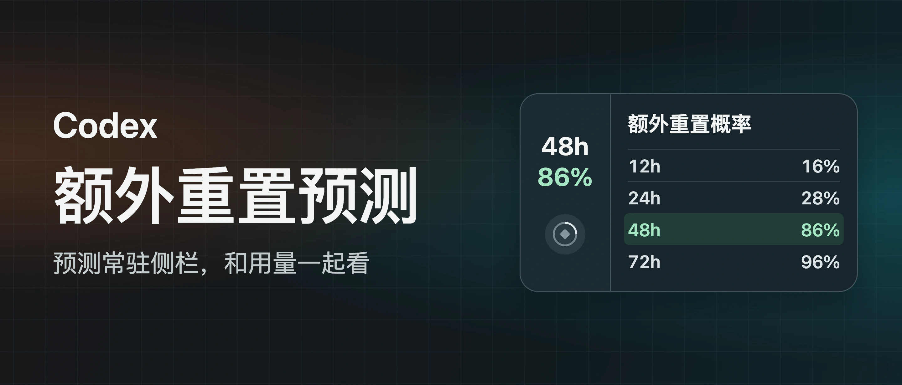
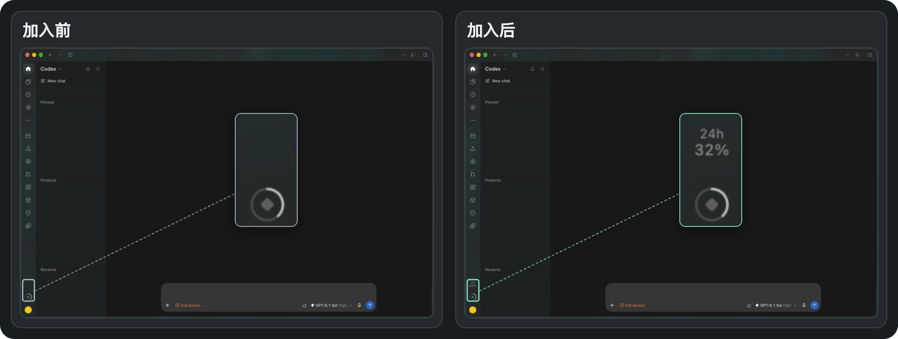

# Codex 额外重置预测

[English](README.md) · **简体中文**

> 额外重置预测常驻 macOS 的 Codex 侧栏，与原生用量并排展示。安装一次，之后照常从原来的 Codex 图标打开。

[](#系统要求)
[](#系统要求)
[](#安装)
[](LICENSE)
[](https://github.com/key-student/codex-reset-forecast/stargazers)



*界面示意，图中概率仅作展示。*

[安装](#安装) · [实机对比](#实机对比) · [常见问题](#常见问题) · [Star 趋势](#star-趋势) · [致谢](#致谢)

## 安装

安装前请确认 [系统要求](#系统要求)。

### 下载 ZIP

1. [下载源码 ZIP](https://github.com/key-student/codex-reset-forecast/archive/refs/heads/main.zip) 并解压。
2. 打开「终端」，输入 `cd `（末尾留一个空格），把解压后的项目文件夹拖进终端，再按回车。
3. 在终端运行安装命令。

```bash
bash standalone/install.sh install
```

安装使用当前 macOS 用户权限，无需 `sudo`。

### 使用 Git

```bash
git clone https://github.com/key-student/codex-reset-forecast.git
cd codex-reset-forecast
bash standalone/install.sh install
```

### 首次启动

保存工作，用 `⌘Q` 完全退出 Codex，再从原来的 Dock 或「应用程序」图标打开。启动助手可能会自动重开 Codex 一次。等几秒钟，左下角 Usage 上方出现 `48h` 和百分比后，点击即可查看详情。

### 更新

Git 用户在项目目录运行 `git pull --ff-only`。ZIP 用户重新下载并解压最新源码。然后在项目目录重新运行 `bash standalone/install.sh install`，完全退出并重新打开 Codex。

### 卸载

在项目目录执行卸载命令。

```bash
bash standalone/install.sh uninstall
```

卸载会移除启动任务和运行文件，并保留所选的显示时段。完全退出并重新打开 Codex，即可结束本次运行的本地调试连接。

## 系统要求

- macOS，以及安装在 `/Applications/ChatGPT.app` 的官方 Codex 桌面客户端，并已登录。已用桌面版 `26.1103.60933` 实机验证。
- Node.js 22 或更新版本。可在终端运行 `node --version` 检查。 [Node.js 官方下载](https://nodejs.org/en/download)
- Xcode Command Line Tools，用于编译启动助手。若尚未安装，在终端运行 `xcode-select --install`。 [Apple 安装说明](https://developer.apple.com/documentation/xcode/installing-the-command-line-tools/)

## 功能

- **四个预测时段**。点击左下角，查看未来 12、24、48、72 小时的概率、更新时间和来源。
- **可选常驻时段**。通过「左下角显示」切换，选择即时生效并保存在本机。详情始终显示四个时段。
- **公开预告**。观测站收录明确预告时，显示重置类型、已知时间和可用的原帖链接。
- **跟随 Codex 外观**。支持深浅主题，入口紧贴原生 Usage。Codex 出现下载更新按钮时，预测入口会随侧栏布局移动。

### 实机对比



*加入后，左下角原生用量图标上方新增预测时段和概率。两图取自同一张实机截图，左图隐去预测入口，会话与账号信息已遮盖。*

## 常见问题

### 装好后为什么没有出现预测入口？

在项目目录运行 `bash standalone/install.sh status`，确认启动助手已注册。保存工作，用 `⌘Q` 完全退出 Codex，再从原来的图标打开，等几秒再开始操作。若刚反复启动过，等两分钟再试一次。Codex 更新也可能改变侧栏结构，届时需要适配。

### 左下角显示「—」是什么意思？

打开面板查看状态。可能是首次加载、上游暂时不可达，或预测已经过期。若曾读到数据，详情会保留并标记上次预测。窗口可见时每分钟检查一次，失败后约一分钟可重试。成功的网络请求至少相隔十分钟。

### 概率和个人额度有什么关系？

这里显示的是未来发生额外重置事件的社区估算，事件包括直接恢复额度和发放重置卡。个人剩余额度和常规重置时间仍可在原生 Usage 查看。 [重置观测站](https://codex.gussuriworks.com/zh) · [公开 API 文档](https://github.com/gussuri/codex-reset-observatory#public-api)

## 数据与权限

安装脚本编译启动助手并注册 macOS 用户级启动任务。助手通过本机回环连接定位 Codex 侧栏，应用文件和签名保持原样。Codex 完全退出后，预测后台停止，启动助手继续等待下次启动。

预测后台请求 Codex Reset Observatory 的公开接口，无需 API 密钥。代码不读取对话、账户额度或登录凭据。预测快照保存在内存，所选时段保存在 `~/Library/Application Support/Codex Reset Forecast/data/settings.json`。

## Star 趋势

<a href="https://star-history.com/#key-student/codex-reset-forecast&amp;Date">
  <picture>
    <source media="(prefers-color-scheme: dark)" srcset="https://api.star-history.com/svg?repos=key-student/codex-reset-forecast&amp;type=Date&amp;theme=dark">
    <source media="(prefers-color-scheme: light)" srcset="https://api.star-history.com/svg?repos=key-student/codex-reset-forecast&amp;type=Date">
    
  </picture>
</a>

图表由 Star History 提供。仓库还没有 Star 时，图上会先显示坐标轴。

## 开发

项目没有第三方运行时依赖。用 Node.js 22 或更新版本运行 `npm test`，可验证上游响应解析、请求缓存和设置写入。

## 致谢

- 感谢 **Gussuri Works** 维护 Codex 重置观测站，持续整理重置历史、跟踪公开预告并提供预测。本项目通过观测站的公开 API 获取侧栏显示的概率和预告。 [观测站](https://codex.gussuriworks.com/zh) · [公开 API 文档](https://github.com/gussuri/codex-reset-observatory#public-api)
- 感谢 **Lorie7813** 开源 Codex Usage Card，为本项目的 macOS 独立启动方式提供参考。 [Codex Usage Card v0.9.5 Beta](https://github.com/Lorie7813/codex-usage-card/releases/tag/v0.9.5-beta.1)

## 许可证

[MIT License](LICENSE)
